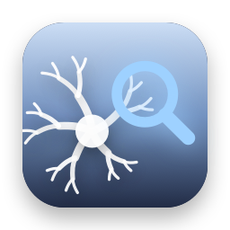
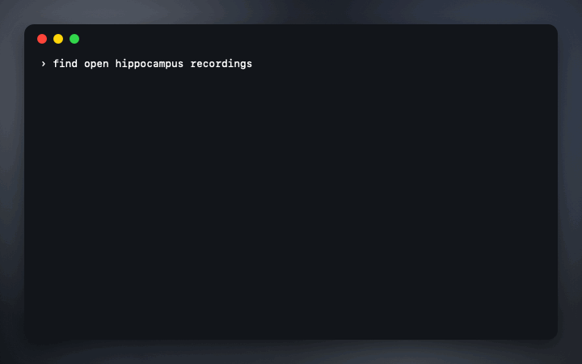

<p align="center">
  
</p>

<h1 align="center">brainhound</h1>

<p align="center">
  <b>Search and read public neuroscience data from your coding agent.</b><br>
  An MCP server, CLI and agent skills for DANDI, OpenNeuro, NeuroMorpho, the Allen brain atlas and BrainGlobe. It reads NWB files where they sit, a slice at a time, and gives every dataset's license and citation. Read-only, no dependencies, no keys.
</p>

<p align="center">
  <a href="#set-it-up"><b>Set it up</b></a>
  &nbsp;·&nbsp;
  <a href="https://stanczykwyatt.github.io/brainhound/">Website</a>
  &nbsp;·&nbsp;
  <a href="skills/">Skills</a>
  &nbsp;·&nbsp;
  <a href="evals/questions.json">Evals</a>
  &nbsp;·&nbsp;
  <a href="https://github.com/users/stanczykwyatt/projects/1">Roadmap</a>
</p>

<p align="center">
  <a href="https://github.com/stanczykwyatt/brainhound/actions/workflows/ci.yml"></a>
  <a href="https://github.com/stanczykwyatt/brainhound/releases/latest"></a>
  
  
  <a href="LICENSE"></a>
</p>

<p align="center">
  
</p>

---

There's a lot of open neuroscience data: hundreds of dandisets and petabytes of recordings on DANDI, MRI and EEG studies on OpenNeuro, over 300,000 traced neurons on NeuroMorpho. Finding the right dataset still means four websites, four search boxes, and downloading a 10 GB file to see what's inside it.

brainhound gives your agent (or you, in a terminal) one way in. Ask for hippocampus recordings and it searches all three archives at once. Ask what's in a session and it opens the NWB file on DANDI's servers, reading only the bytes it needs. Ask for unit 3's spike times and you get them, with the dataset's license and the citation to use.

**Measured** on a real 8.4 GB recording ([dandiset 000003](https://dandiarchive.org/dandiset/000003)): summarizing the whole session read **1.3 MB in 20 range requests, about 3 seconds**. Reading three samples of its 37-million-row LFP phase series took 590 KB. The [eval questions](evals/questions.json) check facts like these against the live archives: `node scripts/run-evals.mjs --live` gets **12 of 12** today.

If it saves you a download, [starring the repo](https://github.com/stanczykwyatt/brainhound/stargazers) helps other people find it.

## The tools

| Tool | What you get |
|---|---|
| `search_datasets` | Matches from DANDI, OpenNeuro and NeuroMorpho at once, each with its id and license |
| `dataset_info` | Description, species, techniques, subjects, size, authors, related papers, license and a ready-to-paste citation |
| `list_files` | The files in a dandiset or OpenNeuro dataset, with sizes |
| `nwb_summary` | What's in an NWB session: subject, devices, electrodes, units and every series with its type and shape |
| `nwb_tree` | The groups and datasets inside a file, with NWB types, shapes, dtypes, units and rates |
| `nwb_read` | A slice of any dataset, with its unit and scaling, simple stats and the values |
| `nwb_table` | Rows of an NWB table (units, trials, electrodes), with ragged columns like spike times followed for you |
| `brain_region` | A region's Allen acronym, id, full name, color and chain of parent regions (mouse, human, developing mouse) |
| `brain_atlases` | BrainGlobe's reference atlases, with species, voxel size and citation |
| `neuron_morphology` | One NeuroMorpho neuron: metadata, morphometry, SWC and image links, and its three citations |

They take ids the way people paste them: `dandi:000003`, `openneuro:ds000001`, `neuromorpho:n419`, or a link to any of them. An NWB file is `dandi:<dandiset>/<path>`, as `list_files` prints it.

## Skills

Four skills in the open [Agent Skills](https://agentskills.io/) format teach an agent how to use the data well, not just how to call the tools:

- **[finding-neuro-datasets](skills/finding-neuro-datasets/SKILL.md):** turning a research question into searches, comparing candidates, and passing on licenses and citations.
- **[reading-remote-nwb](skills/reading-remote-nwb/SKILL.md):** NWB conventions (units and conversion, timestamps versus rate, ragged columns, electrode regions) and sizing reads, plus streaming in Python for heavy analysis.
- **[allen-brain-regions](skills/allen-brain-regions/SKILL.md):** matching region names across labs with the Allen ontology, and choosing a BrainGlobe atlas.
- **[neuromorpho-morphology](skills/neuromorpho-morphology/SKILL.md):** finding and comparing reconstructions fairly, and reading SWC files.

```bash
npx skills add stanczykwyatt/brainhound
```

or `gh skill install stanczykwyatt/brainhound`. Both put them where Claude Code, Codex, Cursor, Gemini CLI and other skill-aware agents look.

## Set it up

You need Node 20 or later. No accounts or keys: everything it reads is public.

**Claude Code:**

```bash
claude mcp add brainhound -- npx -y github:stanczykwyatt/brainhound#v0.1.0 serve
```

**Codex** (`~/.codex/config.toml`):

```toml
[mcp_servers.brainhound]
command = "npx"
args = ["-y", "github:stanczykwyatt/brainhound#v0.1.0", "serve"]
```

**Gemini CLI** (`~/.gemini/settings.json`), **Cursor** (`.cursor/mcp.json`) and **Claude Desktop** the same way:

```json
{ "mcpServers": { "brainhound": { "command": "npx", "args": ["-y", "github:stanczykwyatt/brainhound#v0.1.0", "serve"] } } }
```

Any other MCP client works the same: the command is `npx -y github:stanczykwyatt/brainhound#v0.1.0 serve`. `npx` fetches it from GitHub the first time, which takes a few seconds; to skip that, `npm install -g github:stanczykwyatt/brainhound#v0.1.0` once and use `brainhound serve`.

**Your own files.** To let it open NWB or HDF5 files on your computer too, add `--files /path/to/data` after `serve`. Only files inside that folder can be opened, and only read.

### From the terminal

The same answers, for you:

```bash
npx github:stanczykwyatt/brainhound search hippocampus place cells
npx github:stanczykwyatt/brainhound info dandi:000003
npx github:stanczykwyatt/brainhound files dandi:000003
npx github:stanczykwyatt/brainhound summary dandi:000003/sub-YutaMouse20/sub-YutaMouse20_ses-YutaMouse20-140327_behavior+ecephys.nwb
npx github:stanczykwyatt/brainhound table <that file> /units --columns cell_type,spike_times --count 5
npx github:stanczykwyatt/brainhound region CA1
```

In the terminal, `summary`, `tree`, `read` and `table` also open local files in the current folder.

## Licenses and credit, built in

Open data comes with conditions, and agents are quick to drop them. brainhound puts them in every answer, word for word from the source:

- **DANDI:** each dandiset's own license (usually CC BY 4.0 or CC0) and DANDI's citation with the version DOI.
- **OpenNeuro:** the dataset's license (usually CC0) and a citation with its authors, year and DOI, plus how the authors ask to be acknowledged.
- **NeuroMorpho.Org:** CC BY 4.0, and the three citations its terms ask for: the original paper, NeuroMorpho.Org itself, and its 2024 paper.
- **Allen Institute:** a plain notice that its content is for research and other noncommercial use only, and the atlas paper to cite.
- **BrainGlobe:** each atlas's own citation, and BrainGlobe's.

## Safe to give an agent

- **Read-only.** Every tool only reads. Nothing is written to disk: no cache, no log, no downloads.
- **Only the archives.** It connects to six fixed hosts over https, and refuses any other address, including redirects elsewhere. An agent can't point it at your network or a random URL. Requests to each host are spaced out, with a plain user agent and no cookies.
- **Small reads.** NWB files are read with range requests, a few kilobytes at a time; one call reads at most 128 MB, and answers are capped so a huge dataset can't flood the agent.
- **No local files unless you say so,** and then only inside the folder you name, checked after following links.
- **No dependencies.** About 3,000 lines of plain JavaScript using only Node's own modules, including its own read-only HDF5 reader. CI checks the rules on every change.

The details are in [SECURITY.md](SECURITY.md).

## FAQ

**How can it read an NWB file without downloading it?**
NWB files are HDF5. brainhound has a small HDF5 reader of its own that asks the server for just the byte ranges it needs: the file's index first, then only the compressed chunks your slice touches. DANDI keeps its files on Amazon S3, which answers range requests directly.

**Which HDF5 files can it read?**
Files written with HDF5's default settings, which is what pynwb, h5py and MatNWB write, and files in the newest format, with gzip, shuffle and fletcher32 compression. Files compressed with other filters (Blosc, Zstandard, LZF) and NWB files stored as Zarr say so plainly instead. MATLAB v7.3 `.mat` files are HDF5 too, so local ones open.

**Does it replace pynwb or the DANDI client?**
No. It's for finding and looking: what's in this session, what do these numbers look like, which file do I want. For full analysis, stream the file with pynwb and remfile; the [reading-remote-nwb skill](skills/reading-remote-nwb/SKILL.md) shows how.

**How is it different from other neuroscience MCP servers?**
Most cover one archive. brainhound searches several at once, reads NWB slices remotely without a Python stack, puts a license and citation on every result, ships skills alongside the tools, and has an eval set you can rerun. It's read-only by design, which answers the question of whether an agent's data tools can write files.

**Which agents has it been tried with?**
Its MCP server follows the 2025-11-25 protocol, and its tests drive it over stdio the way an agent does. It hasn't been run inside a live agent session yet. Reports from your agent are very welcome in Discussions.

## More free tools

**Mac apps**

- **[Show Desktop](https://github.com/stanczykwyatt/show-desktop):** hide every window with one click or ⌃⇧D, then bring them all back exactly as they were.
- **[Copy 2FA](https://github.com/stanczykwyatt/copy-2fa):** copy 2FA codes from Mail, Messages or a built-in authenticator with one keyboard shortcut.
- **[Who Stole My Focus](https://github.com/stanczykwyatt/who-stole-my-focus):** find out which app keeps jumping in front of your work.
- **[AI Footprint](https://github.com/stanczykwyatt/ai-footprint):** see what AI coding tools leave on your Mac, and what each update changed.
- **[Memo Export](https://github.com/stanczykwyatt/memo-export):** export your Voice Memos transcripts as Markdown, with the audio.
- **[Podcast Export](https://github.com/stanczykwyatt/podcast-export):** export your Apple Podcasts shows as OPML, and your listening history.
- **[Reading List Export](https://github.com/stanczykwyatt/reading-list-export):** export your Safari Reading List as Markdown, bookmarks and CSV.
- **[Unblock Eject](https://github.com/stanczykwyatt/unblock-eject):** see what's keeping your disk from ejecting, and quit it politely.
- **[Next Departures](https://github.com/stanczykwyatt/next-departures):** your stop's next bus and train, live, in the menu bar.
- **[Right Folder](https://github.com/stanczykwyatt/right-folder):** Open and Save dialogs, in the right folder. A free Default Folder X alternative.
- **[Tonecap](https://github.com/stanczykwyatt/tonecap):** design your keyboard's sound, with no recordings, and hear it as you type.
- **[SciLook](https://github.com/stanczykwyatt/scilook):** Quick Look for NWB, HDF5, MATLAB and NumPy files on your Mac.

**Windows**

- **[Who Stole My Focus for Windows](https://github.com/stanczykwyatt/who-stole-my-focus-windows):** the focus-thief finder as a Windows tray app (preview).

**For coding agents**

- **[mulligan](https://github.com/stanczykwyatt/mulligan):** undo for coding agents: snapshots at every prompt and tool call, for macOS and Linux.
- **[symbolhop](https://github.com/stanczykwyatt/symbolhop):** go-to-definition and find-references for coding agents, from your language servers.

**For neuroscience data**

- **[dropslice](https://stanczykwyatt.github.io/dropslice/):** open NWB, HDF5, MATLAB, NumPy and Zarr files in your browser.

**On the web**

- **[Openfume](https://stanczykwyatt.github.io/openfume/):** an open fragrance database you can search by notes and accords.

Next Departures fetches only the transit feeds you pick, brainhound reads only public neuroscience archives, and dropslice and Openfume are web pages that never upload your files. The rest have no internet access.

## License

brainhound is released under the [MIT License](LICENSE) and is provided as is, without warranty of any kind. The data it reads belongs to its authors and archives, under their own licenses, which brainhound shows with every result.

brainhound is an independent project, not affiliated with or endorsed by the DANDI Archive, OpenNeuro, NeuroMorpho.Org, the Allen Institute, BrainGlobe, the NWB project or any agent maker. Their names are used only to say what brainhound works with. Claude and Claude Code are trademarks of Anthropic, PBC, Codex of OpenAI, Gemini of Google LLC, and Cursor of Anysphere, Inc. The test files are made up. The demo is drawn from brainhound's real output for the public DANDI dandiset 000003.
